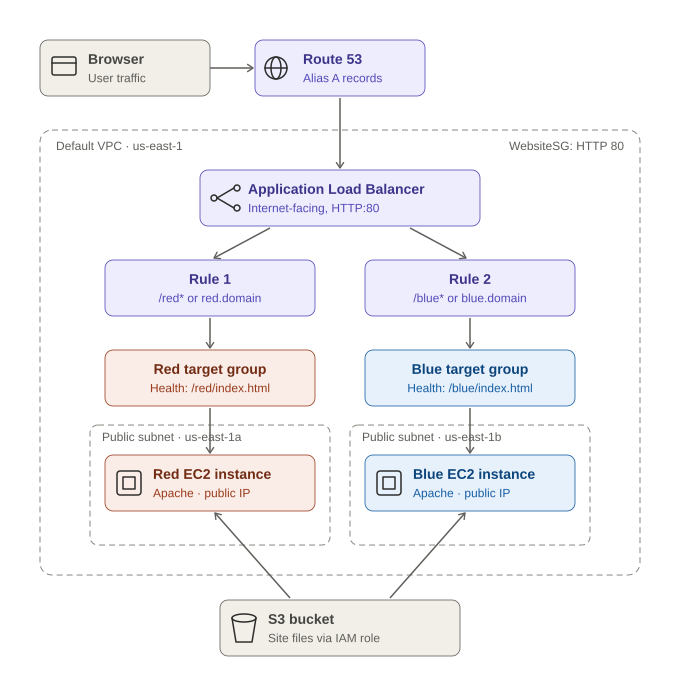

# Load Balanced Website with Advanced Request Routing on AWS (CLI Edition)

A beginner-friendly, step-by-step guide. You will build two small websites (**Red** and **Blue**) on separate servers, put one **load balancer** in front of them, and teach the load balancer to send each visitor to the right server, first by **URL path** and then by **domain name**. Everything is done from the command line, with an explanation of *why* behind each step.

> **Keep `architecture-public.svg` in the same folder as this README** so the diagram below displays.

## Contents

1. [Project overview](#1-project-overview)
2. [The architecture](#2-the-architecture)
3. [Services used and why](#3-services-used-and-why)
4. [Key ideas explained](#4-key-ideas-explained)
5. [Before you start](#5-before-you-start)
6. [Exercise 1: Create the Red and Blue EC2 instances](#exercise-1-create-the-red-and-blue-ec2-instances)
7. [Exercise 2: Path-based routing](#exercise-2-path-based-routing)
8. [Exercise 3: Host-based routing](#exercise-3-host-based-routing)
9. [Exercise 4: Clean up](#exercise-4-clean-up)
10. [Debugging and roadblocks](#debugging-and-roadblocks)

---

## 1. Project overview

**The goal:** one public address that serves different websites depending on the request.

- Visit `http://<load-balancer>/red` and you see the **Red** website.
- Visit `http://<load-balancer>/blue` and you see the **Blue** website.
- Later, visit `http://red.yourdomain.com` or `http://blue.yourdomain.com` and get the same result, based on the *domain name* instead of the path.

**Why this matters in the real world:** companies rarely run one server per website. A single load balancer can sit in front of many applications (a shop, a blog, an API), spread traffic across several servers so none is overloaded, and stop sending traffic to a server that has crashed. This project teaches that pattern at small scale.

**What you will learn:**
- Launching servers (EC2) and giving them software automatically at boot
- Giving servers permission to read private files without storing passwords (IAM roles)
- Controlling network traffic with security groups
- Using an Application Load Balancer with target groups, listeners and rules
- Pointing a real domain name at a load balancer with Route 53
- Cleaning up so you aren't billed for leftovers

---

## 2. The architecture




**How a request flows (host-based version):**

1. You type `red.yourdomain.com` in a browser.
2. **Route 53** (the DNS service) translates that name into the load balancer's address.
3. The **Application Load Balancer** receives the request on port 80.
4. The ALB's **listener rules** check the request. "Is the path `/red*` or the host `red.yourdomain.com`? Then use the Red target group."
5. The **target group** picks a healthy server it manages (the Red EC2 instance).
6. The **EC2 instance** (running the Apache web server) returns the Red web page.

At boot, each instance pulled its website files from an **S3 bucket**, using permissions from an **IAM role**.

**Colour key in the diagram:** purple is routing (Route 53, load balancer, rules), coral is everything Red, blue is everything Blue, and grey is the client and storage.

---

## 3. Services used and why

| Service | What it is (plain English) | Why we use it here |
|---|---|---|
| **EC2** | Virtual servers you rent by the hour | Hosts the Red and Blue websites (one server each) |
| **Application Load Balancer (ALB)** | A traffic director that accepts web requests and forwards them to servers | The single public "front door". It can route by URL path or domain name |
| **Target group** | A named list of servers the ALB can send traffic to, with a health check | Lets the ALB treat "all Red servers" as one unit and skip broken ones |
| **Listener and rules** | The listener waits for traffic on a port; rules decide where each request goes | This is where path-based and host-based routing is configured |
| **S3** | Cloud file storage | Holds the website files so the servers can download them at boot |
| **IAM role + instance profile** | A set of permissions that a server can "wear" | Lets the servers read the S3 bucket without any stored passwords or keys |
| **Security group** | A firewall attached to a resource | Allows web traffic (port 80) in, and nothing else |
| **VPC and subnets** | Your private network in AWS, divided into smaller sections | The network everything lives in. We use the account's **default VPC** |
| **Route 53** | DNS, the internet's phone book | Maps `red.` and `blue.yourdomain.com` to the load balancer |
| **Systems Manager (Session Manager)** | A way to open a shell on a server through AWS | Optional, used for debugging without SSH keys |
| **AWS CLI** | A tool to control AWS from the terminal | Every step in this guide uses it, so the work is repeatable |

---

## 4. Key ideas explained

**Path-based routing.** The load balancer looks at the *path* in the URL (the part after the domain). `/red` goes to Red, `/blue` goes to Blue. Everything uses one address.

**Host-based routing.** The load balancer looks at the *host header*, which is the domain name the visitor typed. `red.yourdomain.com` goes to Red, `blue.yourdomain.com` goes to Blue. This lets one load balancer serve several domains.

**Health check.** The load balancer regularly requests a specific page (like `/red/index.html`) from each server. If the page loads, the server is "healthy". If not, traffic stops going there. This is why each website has its own check path.

**User data.** A script you give a server at launch. The server runs it once, on first boot. Ours installs Apache and downloads the website from S3, so servers set themselves up with no manual steps.

**IAM role and instance profile.** A *role* is a bundle of permissions. An *instance profile* is the wrapper that lets an EC2 server use a role. The console creates the wrapper for you, but with the CLI you must create it explicitly.

**Alias record.** A Route 53 DNS record that points a name straight at an AWS resource (our load balancer), which is the AWS-friendly alternative to a plain CNAME.

**Why two availability zones?** An AZ is a separate data centre in a region. Spreading across two means one failing doesn't take everything down. The ALB must be placed in at least two AZs anyway.

---

## 5. Before you start

### What you need

| Requirement | Notes |
|---|---|
| AWS account and **AWS CLI v2** | Check with `aws sts get-caller-identity`; it should show your account |
| Permissions | You need access to EC2, ELB, IAM, S3, Route 53 and SSM |
| Course zip extracted | `advanced-request-routing-code.zip`; the commands read files from this folder |
| A domain in Route 53 | **Exercise 3 only.** Registering a domain is easiest in the console |

### Files you should have

The website files (`hw-red.css`, `hw-red-py.css`, `python.png`, `apache.svg`, `red-index.html`, `red-root-index.html` and the blue equivalents) plus `user-data-red` and `user-data-blue`. Open the user data files and note which files they download from S3. Those exact files must be in your bucket.

### A mini primer on the commands

You'll see the same patterns repeatedly:

| Pattern | Meaning |
|---|---|
| `export NAME=value` | Stores a value in a **shell variable** so later commands can reuse it as `$NAME` |
| `$(command)` | Runs the command and substitutes its output, e.g. `VPC_ID=$(aws ec2 describe-vpcs ...)` |
| `--query '...'` | Filters AWS's JSON reply down to just the value you want |
| `--output text` | Prints plain text instead of JSON, ideal for storing in a variable |
| `aws ... wait ...` | Pauses until a resource reaches a state (running, available) |
| `\` at the end of a line | The command continues on the next line |

### Work from one folder

`cd` into the extracted folder and stay there. The commands use relative paths (such as `user-data-red`), and the files they create (like `ud-red.sh`) land in the current folder.

```bash
cd ~/Downloads/advanced-request-routing-code     # use your own path
ls                                                # you should see user-data-red etc.
```

### Set your variables

**What:** define settings you'll reuse. **Why:** typing IDs by hand is error-prone, and the region must be consistent because AWS resources are regional.

```bash
export AWS_DEFAULT_REGION=us-east-1
export ACCOUNT_ID=$(aws sts get-caller-identity --query Account --output text)

# CHANGE THESE
export BUCKET=arr-bucket-$RANDOM$RANDOM     # S3 bucket names must be globally unique
export DOMAIN=yourdomainname.com            # needed for Exercise 3 only

# Helper that saves variables to env.sh, so you can restore them in a new terminal
save() { for v in "$@"; do echo "export $v=$(eval echo \$$v)" >> env.sh; done; }
save AWS_DEFAULT_REGION ACCOUNT_ID BUCKET DOMAIN
```

**What the helper does:** `save SG_ID VPC_ID` appends lines like `export SG_ID=sg-0123...` to `env.sh`. If you close the terminal, run `source env.sh` (and paste the `save()` line again) to get everything back. Resource IDs are all you need, so there are no secrets in the file.

---

## Exercise 1: Create the Red and Blue EC2 instances

### Task 1: Create the S3 bucket and upload the code

**What:** create a private storage bucket and upload the website files. **Why:** the servers need somewhere to fetch the site from at boot. Keeping the files in S3 means the same user data script works for any number of servers.

```bash
aws s3api create-bucket --bucket $BUCKET

aws s3 cp . s3://$BUCKET/ --recursive \
  --exclude "user-data*" --exclude "bucket-permissions*" \
  --exclude "*.zip" --exclude "env.sh" --exclude "README*" \
  --exclude "*.svg" --exclude "ud-*" --exclude "*.json"

aws s3 ls s3://$BUCKET/
```

- The first command creates the bucket (in `us-east-1` no location setting is needed).
- The second uploads everything in the current folder **except** files that aren't part of the website (user data scripts, this README, and so on). `--exclude` skips matching files.
- The last lists what's there.

**Check:** the listing should contain every file your user data scripts download (for example `red-index.html`, `red-root-index.html`, `python.png`).

> **Don't add a bucket policy that denies access to everyone.** The servers read the bucket through their IAM role, so no bucket policy is needed. A blanket Deny would also lock you out.

### Task 2: Create your security group

**What:** a firewall that allows web traffic in. **Why:** by default, AWS blocks all incoming traffic to a server. We need to allow HTTP (port 80) so the load balancer and our browser tests can reach the websites. We'll use the same group for the ALB and the servers, as the original lab does.

First find the default VPC (the network we'll use):

```bash
export VPC_ID=$(aws ec2 describe-vpcs --filters Name=isDefault,Values=true \
  --query 'Vpcs[0].VpcId' --output text)
```

Then create the group and open port 80:

```bash
export SG_ID=$(aws ec2 create-security-group \
  --group-name WebsiteSG --description WebsiteSG \
  --vpc-id $VPC_ID --query GroupId --output text)

aws ec2 authorize-security-group-ingress --group-id $SG_ID \
  --protocol tcp --port 80 --cidr 0.0.0.0/0

save VPC_ID SG_ID
```

- `--protocol tcp --port 80` is web traffic.
- `--cidr 0.0.0.0/0` means "from anywhere on the internet".

**Check:** `echo $SG_ID` prints something like `sg-0abc...`. If it's empty, the previous command failed.

### Task 3: Create the IAM role and launch the Red instance

#### 3a. The permission policy

**What:** a policy allowing read access to *your* bucket only. **Why:** the principle of least privilege means giving servers just what they need. This policy replaces the lab's `bucket-permissions.json`.

```bash
cat > s3-arr-policy.json <<EOF
{
  "Version": "2012-10-17",
  "Statement": [
    {
      "Effect": "Allow",
      "Action": ["s3:GetObject", "s3:ListBucket"],
      "Resource": [
        "arn:aws:s3:::$BUCKET",
        "arn:aws:s3:::$BUCKET/*"
      ]
    }
  ]
}
EOF

aws iam create-policy --policy-name S3-ARR-Policy \
  --policy-document file://s3-arr-policy.json
```

`GetObject` lets servers download files, `ListBucket` lets them list the bucket, and the two resource lines cover the bucket itself and everything inside it.

#### 3b. The role and instance profile

**What:** a role EC2 is allowed to use, with the policy attached. **Why:** this is how a server gets permissions without any stored password or access key. The **trust policy** says "the EC2 service may use this role".

```bash
cat > ec2-trust.json <<'EOF'
{
  "Version": "2012-10-17",
  "Statement": [{
    "Effect": "Allow",
    "Principal": { "Service": "ec2.amazonaws.com" },
    "Action": "sts:AssumeRole"
  }]
}
EOF

aws iam create-role --role-name S3-ARR-Role \
  --assume-role-policy-document file://ec2-trust.json

aws iam attach-role-policy --role-name S3-ARR-Role \
  --policy-arn arn:aws:iam::$ACCOUNT_ID:policy/S3-ARR-Policy

# Optional but recommended: lets you open a shell via Session Manager for debugging
aws iam attach-role-policy --role-name S3-ARR-Role \
  --policy-arn arn:aws:iam::aws:policy/AmazonSSMManagedInstanceCore

# The console creates the instance profile automatically; the CLI needs it explicitly
aws iam create-instance-profile --instance-profile-name S3-ARR-Role
aws iam add-role-to-instance-profile \
  --instance-profile-name S3-ARR-Role --role-name S3-ARR-Role

sleep 15
```

The `sleep 15` matters. IAM changes take a few seconds to spread across AWS, and launching too soon gives *"Invalid IAM Instance Profile"*.

#### 3c. Find the machine image and the subnets

**What:** look up the operating system image (AMI) and one subnet in each of two AZs. **Why:** the AMI is the server's disk image (we use the latest Amazon Linux 2023, found through a public AWS parameter, so no hard-coded IDs). The two subnets put Red and Blue in different AZs for resilience.

```bash
export AMI_ID=$(aws ssm get-parameter \
  --name /aws/service/ami-amazon-linux-latest/al2023-ami-kernel-default-x86_64 \
  --query Parameter.Value --output text)

get_subnet() { aws ec2 describe-subnets \
  --filters Name=vpc-id,Values=$VPC_ID Name=availability-zone,Values=$1 Name=default-for-az,Values=true \
  --query 'Subnets[0].SubnetId' --output text; }

export SUBNET_A=$(get_subnet us-east-1a)
export SUBNET_B=$(get_subnet us-east-1b)

save AMI_ID SUBNET_A SUBNET_B
```

`get_subnet` is a small function: give it an AZ name and it returns the default subnet there. Default subnets are *public*, meaning they route to the internet.

#### 3d. Prepare the user data and launch Red

**What:** insert your bucket name into the boot scripts, then launch. **Why:** the scripts contain the placeholder `YOUR-BUCKET-NAME`, and `sed` swaps it for your real bucket.

```bash
sed "s/YOUR-BUCKET-NAME/$BUCKET/g" user-data-red  > ud-red.sh
sed "s/YOUR-BUCKET-NAME/$BUCKET/g" user-data-blue > ud-blue.sh

grep -c "$BUCKET" ud-red.sh ud-blue.sh      # both numbers should be greater than 0
```

```bash
export RED_ID=$(aws ec2 run-instances \
  --image-id $AMI_ID --instance-type t2.micro \
  --subnet-id $SUBNET_A --security-group-ids $SG_ID \
  --associate-public-ip-address \
  --iam-instance-profile Name=S3-ARR-Role \
  --user-data file://ud-red.sh \
  --tag-specifications 'ResourceType=instance,Tags=[{Key=Name,Value=Red}]' \
  --query 'Instances[0].InstanceId' --output text)

save RED_ID
```

- `t2.micro` is a small, free-tier-eligible server.
- `--associate-public-ip-address` gives it a public IP so you can test it directly.
- `--iam-instance-profile` attaches the S3 permissions.
- `--user-data file://...` is the boot script (the CLI encodes it for you).
- No key pair is used, matching the lab. You'll use Session Manager if you need a shell.

#### 3e. Check that Red works

```bash
aws ec2 wait instance-running --instance-ids $RED_ID

RED_IP=$(aws ec2 describe-instances --instance-ids $RED_ID \
  --query 'Reservations[0].Instances[0].PublicIpAddress' --output text)

sleep 60
curl -s http://$RED_IP/red/ | head
curl -s http://$RED_IP/ | head
```

**Why the wait:** "running" means the server has *started*, not that user data has *finished*. Installing Apache and copying from S3 takes another minute or two. If curl shows nothing, wait a little and retry.

**Check:** you should see Red's HTML. If not, jump to [User data didn't run](#4-user-data-failed-or-didnt-run).

### Task 4: Launch the Blue instance

Same steps, with the Blue script and the other AZ.

```bash
export BLUE_ID=$(aws ec2 run-instances \
  --image-id $AMI_ID --instance-type t2.micro \
  --subnet-id $SUBNET_B --security-group-ids $SG_ID \
  --associate-public-ip-address \
  --iam-instance-profile Name=S3-ARR-Role \
  --user-data file://ud-blue.sh \
  --tag-specifications 'ResourceType=instance,Tags=[{Key=Name,Value=Blue}]' \
  --query 'Instances[0].InstanceId' --output text)

save BLUE_ID
aws ec2 wait instance-running --instance-ids $BLUE_ID

BLUE_IP=$(aws ec2 describe-instances --instance-ids $BLUE_ID \
  --query 'Reservations[0].Instances[0].PublicIpAddress' --output text)

sleep 60
curl -s http://$BLUE_IP/blue/ | head
```

**Checkpoint:** `/red/` works on the Red server and `/blue/` on the Blue server. If either fails, fix it now, because the load balancer can't succeed if the servers don't.

---

## Exercise 2: Path-based routing

### Task 1: Create the target groups

**What:** one target group per colour, each with its own health check. **Why:** the ALB doesn't send traffic to servers directly. It sends it to *target groups*, so "Red servers" and "Blue servers" are separate sets. The health check path must be a page that actually exists on that server.

```bash
export RED_TG=$(aws elbv2 create-target-group --name Red \
  --protocol HTTP --port 80 --vpc-id $VPC_ID --target-type instance \
  --health-check-path /red/index.html \
  --query 'TargetGroups[0].TargetGroupArn' --output text)

export BLUE_TG=$(aws elbv2 create-target-group --name Blue \
  --protocol HTTP --port 80 --vpc-id $VPC_ID --target-type instance \
  --health-check-path /blue/index.html \
  --query 'TargetGroups[0].TargetGroupArn' --output text)
```

Now register each instance in its group (this is the lab's "include as pending below" step):

```bash
aws elbv2 register-targets --target-group-arn $RED_TG  --targets Id=$RED_ID
aws elbv2 register-targets --target-group-arn $BLUE_TG --targets Id=$BLUE_ID

save RED_TG BLUE_TG
```

An **ARN** (Amazon Resource Name) is the long unique ID AWS gives each resource.

### Task 2: Create the Application Load Balancer

**What:** the ALB itself, plus a listener on port 80. **Why:** the ALB is the public front door. It must span two AZs (we give it both subnets), be **internet-facing** so browsers can reach it, and use our security group so port 80 is allowed.

```bash
export ALB_ARN=$(aws elbv2 create-load-balancer --name LabLoadBalancer \
  --type application --scheme internet-facing \
  --subnets $SUBNET_A $SUBNET_B --security-groups $SG_ID \
  --query 'LoadBalancers[0].LoadBalancerArn' --output text)

aws elbv2 wait load-balancer-available --load-balancer-arns $ALB_ARN
```

It takes a few minutes to go from *provisioning* to *active*, and the `wait` handles that. Then get its address and create the listener:

```bash
export ALB_DNS=$(aws elbv2 describe-load-balancers --load-balancer-arns $ALB_ARN \
  --query 'LoadBalancers[0].DNSName' --output text)

export LISTENER_ARN=$(aws elbv2 create-listener --load-balancer-arn $ALB_ARN \
  --protocol HTTP --port 80 \
  --default-actions Type=forward,TargetGroupArn=$BLUE_TG \
  --query 'Listeners[0].ListenerArn' --output text)

save ALB_ARN ALB_DNS LISTENER_ARN
echo $ALB_DNS
```

The **listener** waits for HTTP traffic on port 80. Its **default action** says "if no rule matches, send to Blue", just as in the lab. Keep the printed DNS name handy, since it's your test address.

### Task 3: Add the path rules

**What:** two rules that match by URL path. **Why:** rules are checked in **priority order** (lowest number first), and the first match wins. The `*` is a wildcard, so `/red*` matches `/red`, `/red/`, `/red/index.html` and so on.

```bash
aws elbv2 create-rule --listener-arn $LISTENER_ARN --priority 1 \
  --conditions Field=path-pattern,Values='/red*' \
  --actions Type=forward,TargetGroupArn=$RED_TG

aws elbv2 create-rule --listener-arn $LISTENER_ARN --priority 2 \
  --conditions Field=path-pattern,Values='/blue*' \
  --actions Type=forward,TargetGroupArn=$BLUE_TG
```

### Task 4: Wait for healthy targets, then test

**Why wait:** a newly registered server starts as *initial* and only becomes *healthy* after several passing health checks. Traffic won't be sent to it until then.

```bash
for TG in $RED_TG $BLUE_TG; do
  aws elbv2 describe-target-health --target-group-arn $TG \
    --query 'TargetHealthDescriptions[].TargetHealth.State' --output text
done
# repeat until both print: healthy
```

Then test through the load balancer:

```bash
curl -s http://$ALB_DNS/red/  | head
curl -s http://$ALB_DNS/blue/ | head
```

**Success:** you get the Red page for `/red/` and the Blue page for `/blue/`, **through the same address**. That's path-based routing. You can also open `http://<ALB_DNS>/red` in a browser (**browser task**).

---

## Exercise 3: Host-based routing

### Task 1: Swap the path rules for host rules

**What:** delete the path rules and match on the domain name instead. **Why:** a path rule and a host rule can conflict, and the lab replaces one with the other. The first command removes every non-default rule.

```bash
for ARN in $(aws elbv2 describe-rules --listener-arn $LISTENER_ARN \
  --query 'Rules[?IsDefault==`false`].RuleArn' --output text); do
  aws elbv2 delete-rule --rule-arn $ARN
done

aws elbv2 create-rule --listener-arn $LISTENER_ARN --priority 1 \
  --conditions Field=host-header,Values=red.$DOMAIN \
  --actions Type=forward,TargetGroupArn=$RED_TG

aws elbv2 create-rule --listener-arn $LISTENER_ARN --priority 2 \
  --conditions Field=host-header,Values=blue.$DOMAIN \
  --actions Type=forward,TargetGroupArn=$BLUE_TG
```

**Test before DNS exists.** `curl` can fake the host header, which proves the rules work independently of DNS:

```bash
curl -s -H "Host: red.$DOMAIN"  http://$ALB_DNS/red/  | head
curl -s -H "Host: blue.$DOMAIN" http://$ALB_DNS/blue/ | head
```

### Task 2: Create the Route 53 records

**What:** DNS records that point your names at the ALB. **Why:** browsers need DNS to turn `red.yourdomain.com` into the load balancer's address. We use **alias** records, which AWS resolves for you.

First collect two IDs: your domain's *hosted zone* (the container for its DNS records) and the ALB's own hosted zone ID, which alias records require.

```bash
export ZONE_ID=$(aws route53 list-hosted-zones-by-name --dns-name $DOMAIN \
  --query 'HostedZones[0].Id' --output text | sed 's|/hostedzone/||')

export ALB_ZONE=$(aws elbv2 describe-load-balancers --load-balancer-arns $ALB_ARN \
  --query 'LoadBalancers[0].CanonicalHostedZoneId' --output text)

save ZONE_ID ALB_ZONE
```

Then describe the records in a JSON file and apply it. `UPSERT` means "create it, or update it if it already exists". We make three records: `red.`, `blue.`, and the bare domain (the *apex*).

```bash
cat > records.json <<EOF
{
  "Changes": [
    { "Action": "UPSERT", "ResourceRecordSet": {
        "Name": "red.$DOMAIN", "Type": "A",
        "AliasTarget": { "HostedZoneId": "$ALB_ZONE", "DNSName": "dualstack.$ALB_DNS", "EvaluateTargetHealth": true } } },
    { "Action": "UPSERT", "ResourceRecordSet": {
        "Name": "blue.$DOMAIN", "Type": "A",
        "AliasTarget": { "HostedZoneId": "$ALB_ZONE", "DNSName": "dualstack.$ALB_DNS", "EvaluateTargetHealth": true } } },
    { "Action": "UPSERT", "ResourceRecordSet": {
        "Name": "$DOMAIN", "Type": "A",
        "AliasTarget": { "HostedZoneId": "$ALB_ZONE", "DNSName": "dualstack.$ALB_DNS", "EvaluateTargetHealth": true } } }
  ]
}
EOF

aws route53 change-resource-record-sets --hosted-zone-id $ZONE_ID \
  --change-batch file://records.json
```

### Task 3: Verify

```bash
dig +short red.$DOMAIN                       # should print IP addresses (the ALB's)
curl -s http://red.$DOMAIN/red/   | head
curl -s http://blue.$DOMAIN/blue/ | head
curl -s http://$DOMAIN/           | head      # apex: no rule matches, so default (Blue)
```

**Success:** different names reach different websites through the same load balancer. Finally, open `http://red.yourdomain.com` and `http://blue.yourdomain.com` in a browser (**browser task**). Use `http://`, since we haven't set up HTTPS.

---

## Exercise 4: Clean up

**Why this matters:** the ALB and EC2 instances bill by the hour even when idle. **Why the order matters:** AWS refuses to delete something that another resource still depends on (for example, a security group still used by a server), so we delete from the outside in.

```bash
# 1. DNS records first (same file, with the action changed to DELETE)
sed 's/UPSERT/DELETE/' records.json > delete-records.json
aws route53 change-resource-record-sets --hosted-zone-id $ZONE_ID \
  --change-batch file://delete-records.json

# 2. Load balancer (its listener and rules go with it), then wait until it is gone
aws elbv2 delete-load-balancer --load-balancer-arn $ALB_ARN
aws elbv2 wait load-balancers-deleted --load-balancer-arns $ALB_ARN

# 3. Target groups (can't be deleted while attached to a listener)
aws elbv2 delete-target-group --target-group-arn $RED_TG
aws elbv2 delete-target-group --target-group-arn $BLUE_TG

# 4. Servers
aws ec2 terminate-instances --instance-ids $RED_ID $BLUE_ID
aws ec2 wait instance-terminated --instance-ids $RED_ID $BLUE_ID

# 5. Security group (only once nothing uses it)
aws ec2 delete-security-group --group-id $SG_ID

# 6. IAM (detach before delete)
aws iam remove-role-from-instance-profile --instance-profile-name S3-ARR-Role --role-name S3-ARR-Role
aws iam delete-instance-profile --instance-profile-name S3-ARR-Role
aws iam detach-role-policy --role-name S3-ARR-Role --policy-arn arn:aws:iam::$ACCOUNT_ID:policy/S3-ARR-Policy
aws iam detach-role-policy --role-name S3-ARR-Role --policy-arn arn:aws:iam::aws:policy/AmazonSSMManagedInstanceCore
aws iam delete-role --role-name S3-ARR-Role
aws iam delete-policy --policy-arn arn:aws:iam::$ACCOUNT_ID:policy/S3-ARR-Policy

# 7. S3 (a bucket must be empty before deletion)
aws s3 rm s3://$BUCKET --recursive
aws s3api delete-bucket --bucket $BUCKET
```

**Confirm nothing billable remains:**

```bash
aws ec2 describe-instances --filters Name=instance-state-name,Values=running \
  --query 'Reservations[].Instances[].InstanceId'
aws elbv2 describe-load-balancers --query 'LoadBalancers[].LoadBalancerName'
```

Both should print an empty list. Also delete `env.sh`, since its IDs no longer exist.

---

## Debugging and roadblocks

### Quick diagnosis by symptom

| Symptom | Likely cause | Fix |
|---|---|---|
| ALB URL times out | Security group blocks port 80, or ALB isn't internet-facing | Check `SG_ID` allows 80 from `0.0.0.0/0`; ALB scheme must be `internet-facing` |
| **503 Service Unavailable** | No healthy targets registered | [Check target health](#1-check-target-health) |
| **502 Bad Gateway** | Server is up but not answering correctly on port 80 | Check Apache is running; target group must be HTTP:80 |
| **404 from Apache** | Server is fine but the page isn't there | S3 copy failed in user data; check `/var/www/html/red` |
| Target stays `unhealthy` | Health check path doesn't exist on the server | Must be `/red/index.html` or `/blue/index.html` |
| `/red/` shows the Blue page | Rule missing, or its priority is wrong | `aws elbv2 describe-rules --listener-arn $LISTENER_ARN` |
| Host test returns the wrong page | Host header doesn't match the rule exactly | Use `curl -H "Host: red.$DOMAIN"`; compare with the rule |
| `dig` returns nothing | DNS not propagated, or record in the wrong zone | Check `echo $ZONE_ID`; wait a few minutes |
| `http` works, `https` doesn't | No HTTPS listener exists | Use `http://` (HTTPS needs a certificate and a port 443 listener) |

### 1. Check target health

```bash
aws elbv2 describe-target-health --target-group-arn $RED_TG
aws elbv2 describe-target-health --target-group-arn $BLUE_TG
```

Read the `Reason` and `Description` fields:
- `Target.FailedHealthChecks`: the server answered with something other than success. Test the path directly: `curl -i http://$RED_IP/red/index.html`.
- `Target.Timeout`: nothing answered. The security group may block port 80, or Apache isn't running.
- `Target.NotRegistered` / `Target.NotInUse`: the server isn't in the group, or the group isn't used by any listener rule.

### 2. Open a shell on a server (Session Manager)

No SSH key is needed. Install the [Session Manager plugin](https://docs.aws.amazon.com/systems-manager/latest/userguide/session-manager-working-with-install-plugin.html) first (`brew install --cask session-manager-plugin` on a Mac).

```bash
aws ssm start-session --target $RED_ID
```

Inside the server:

```bash
systemctl status httpd
ls -R /var/www/html
curl -s localhost/red/
sudo tail -n 80 /var/log/cloud-init-output.log
```

If it says the target isn't connected, wait 2 to 5 minutes after launch, and confirm the role has `AmazonSSMManagedInstanceCore`. No shell at all? Read the boot log from your own machine:

```bash
aws ec2 get-console-output --instance-id $RED_ID --latest --output text | tail -n 80
```

### 3. Check the instance is in a public subnet with a public IP

```bash
aws ec2 describe-instances --instance-ids $RED_ID \
  --query 'Reservations[0].Instances[0].[PublicIpAddress,SubnetId]'
```
No public IP means the instance has no internet path, so user data can't download packages. Relaunch with `--associate-public-ip-address`.

### 4. User data failed or didn't run

- **`YOUR-BUCKET-NAME` not replaced:** `grep YOUR-BUCKET ud-red.sh` should print nothing.
- **S3 `AccessDenied`:** the instance profile isn't attached, or the policy points at a different bucket. Check the profile with `aws ec2 describe-instances --instance-ids $RED_ID --query 'Reservations[0].Instances[0].IamInstanceProfile'`.
- **S3 `NoSuchKey`:** a file named in the script isn't in the bucket. Compare with `aws s3 ls s3://$BUCKET/`.
- **User data only runs on first boot.** After fixing a script, relaunch the instance (or run the commands by hand in Session Manager).
- **Still installing:** `yum update` can take a couple of minutes, so wait and retry.

### 5. IAM errors

- `Invalid IAM Instance Profile name`: the instance profile doesn't exist yet, or IAM hasn't propagated. Confirm with `aws iam get-instance-profile --instance-profile-name S3-ARR-Role`, wait 15 seconds and retry.
- Attach a profile to a running instance: `aws ec2 associate-iam-instance-profile --instance-id $RED_ID --iam-instance-profile Name=S3-ARR-Role`.

### 6. Security group problems

```bash
aws ec2 describe-security-groups --group-ids $SG_ID --query 'SecurityGroups[0].IpPermissions'
```
You should see TCP port 80 from `0.0.0.0/0`. `InvalidPermission.Duplicate` just means the rule already exists, which is fine.

### 7. Listener rules

```bash
aws elbv2 describe-rules --listener-arn $LISTENER_ARN \
  --query 'Rules[].{Priority:Priority,Cond:Conditions[0].Values,TG:Actions[0].TargetGroupArn}'
```
- Lower priority numbers are checked first, and the default rule is last.
- Path patterns are case-sensitive (`/red*`, not `/Red*`).
- Delete old path rules before testing host rules.
- `PriorityInUse`: delete the old rule before reusing its number.

### 8. Route 53

- **Empty `ZONE_ID`:** the domain needs a public hosted zone in *this* account.
- **Alias rejected:** `ALB_ZONE` must be the **ALB's** `CanonicalHostedZoneId`, not your own zone's ID.
- **Existing conflicting record** (for example a CNAME with the same name): delete it first.
- DNS can take a few minutes. Meanwhile use the `curl -H "Host: ..."` method, or `dig @8.8.8.8 red.$DOMAIN`.

### 9. Cleanup errors

| Error | Cause | Fix |
|---|---|---|
| `DependencyViolation` deleting the security group | ALB network interfaces or instances still exist | Wait for them to finish deleting, then retry |
| `ResourceInUse` deleting a target group | Still attached to a listener | Delete the ALB first |
| `BucketNotEmpty` | Objects remain | `aws s3 rm s3://$BUCKET --recursive`, then delete |
| `DeleteConflict` deleting the role | Still attached or in an instance profile | Detach policies and remove the role from the profile first |

### 10. General tips

- **Wrong region or account?** Run `aws sts get-caller-identity` and `echo $AWS_DEFAULT_REGION`. Most "not found" errors are caused by this.
- **Empty variables** cause confusing errors. `echo $VAR` before using it, and `source env.sh` in a new terminal.
- **Add `--debug`** to any command to see the raw requests and responses.
- **Watch the cost:** run Exercise 4 as soon as you're done testing.
